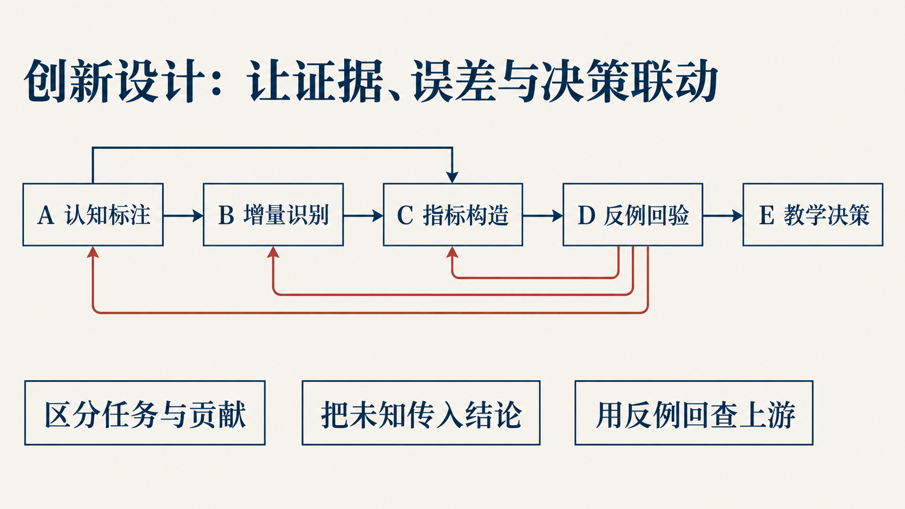
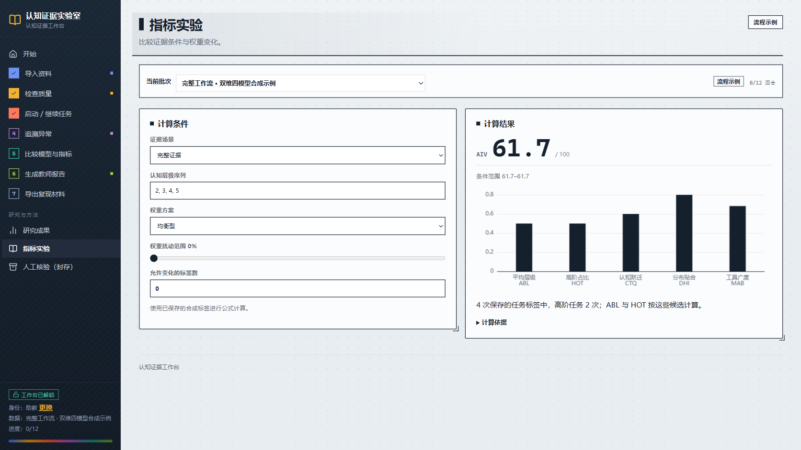
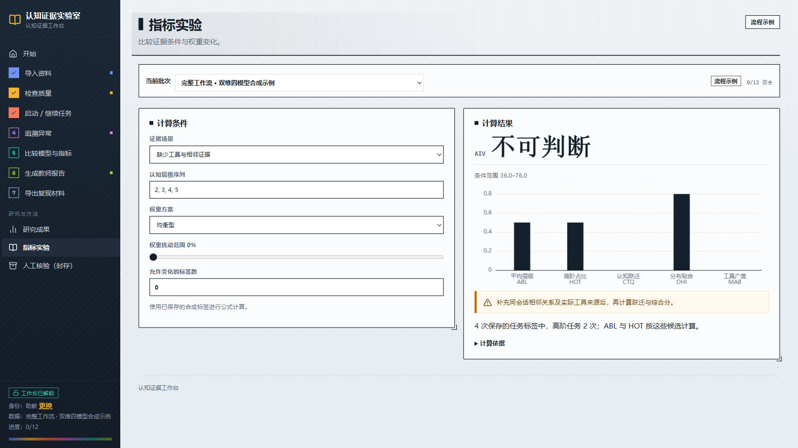
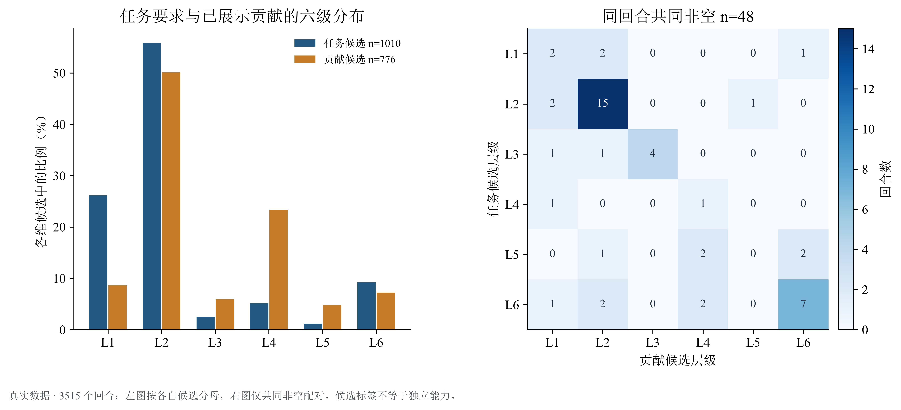
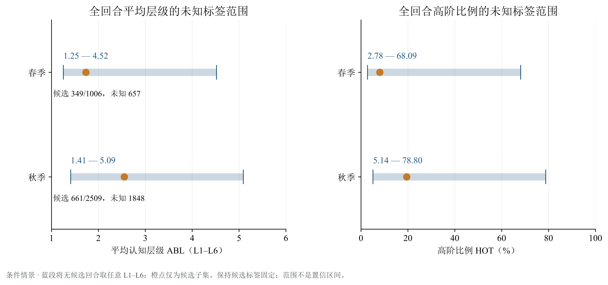

[简体中文](README.md) · **English**

# Nanxing · Evaluating the Added Value of AI-assisted Learning

**Start with evidence from the learning process, distinguish task demands from student contributions, and turn evaluation into teaching actions that can be checked.**

[Project homepage · Online workbench](https://math.hnnu.team/) · [Paper PDF](build/paper/main.pdf) · [20-slide presentation](slides/README.md) · [Notebooks](notebooks/README.md) · [Reproduction guide](docs/复现说明.md)

*This repository is archived and retained for reference and reproduction. The paper, presentation, figures, and supporting guides are primarily in Chinese.*


Learning platforms record questions, responses, and tool use. How strong an evaluation can those records support? Nanxing connects cognitive annotations, comparison conditions, indicator ranges, counterexample tests, and teacher reports while retaining gaps in the evidence and disagreements in judgments.

| Research records | Two-dimensional measurement | Review under the same conditions | What can actually be computed |
| --- | --- | --- | --- |
| **3,515** real interaction turns | **1,010 / 776** task-demand / student-contribution candidates | **352** fixed randomly sampled turns | Conditional score ranges for **356** student–semester units |
| From **401** student–semester units | **48** turns with candidates in both dimensions | **827** high-risk turns reported separately | **0** complete AIV cases available |

## Choose your entry point

| Your purpose | Start here | What you will find |
| --- | --- | --- |
| Read the research findings | [Paper](build/paper/main.pdf) → [Results guide](docs/结果阅读指南.md) | Five figure groups, denominators, conditions, and interpretations |
| View the complete presentation | [Slides and speaker notes](slides/README.md) | 12 main slides, 7 backup slides, and 1 acknowledgments slide |
| Recalculate the results | [Notebook guide](notebooks/README.md) → [00 Overview](notebooks/00_论文材料总览.ipynb) | Ten executed Notebooks, synthetic cases, and verification of public aggregate results |
| Try the teaching workflow | [Online workbench](https://math.hnnu.team/) · [Run locally](workbench/README.md) | Material import, model judgments, disagreement review, and reports |
| Reuse the methods and code | [Reproduction guide](docs/复现说明.md) · [Indicator definitions](docs/指标定义与性质.md) | Input requirements, computation entry points, dependencies, and adaptation guidance |

GitHub can display the figures saved in the Notebooks directly. After downloading the repository, open the [offline illustrated index](build/notebooks/index.html) and [presentation player](slides/roadshow/player/index.html) in a browser.

## From evidence to action



| Stage | Question | Implementation to inspect |
| --- | --- | --- |
| **A · Measurement** | What cognitive activity does the question require? What has the student actually demonstrated? | Independent annotation of two dimensions, multiple-model review, and human comparison of the same questions |
| **B · Comparison** | Do the data support attributing a change to AI? | Temporal order, treatment definitions, comparable groups, and missing conditions |
| **C · Indicators** | How should scores be reported when evidence is incomplete? | Five-dimensional indicators, ranges for unknown components, and sensitivity to weights and labels |
| **D · Testing** | Can scores be manipulated by adding tools or matching a target distribution? | Synthetic counterexamples and rule revisions |
| **E · Action** | What should teachers check or collect next? | Evidence summaries, disagreement flags, and recommendations for further data collection |

See the [AI reasoning process](docs/AI解题过程.md) for the roles and conditions of independent AI judgments, random review, high-risk review, and human-assisted reassessment.

## Run two cases first

Requires **Python 3.13**. Create an environment in the repository root and install the locked dependencies:

```powershell
python -m venv .venv
.venv\Scripts\python.exe -m pip install -r requirements-lock.txt
.venv\Scripts\python.exe -X utf8 -B scripts/demo_evidence_chain.py
```

On macOS or Linux, replace `.venv\Scripts\python.exe` with `.venv/bin/python`. These two cases use saved **synthetic labels** and run offline, without an API key or TeX.

| Complete evidence | Missing conversation and tool evidence |
| --- | --- |
|  |  |
| All five indicators are computable; the balanced score is approximately **61.65** | CTQ, MAB, and the point score are `null`; the conditional range is **36–76** |
| Read the observed evidence and recommended actions | Inspect the missing adjacency relationships and tool provenance |

You can then execute all ten Notebooks. Figures require **SimSun and Times New Roman**. See the [reproduction guide](docs/复现说明.md) for environment requirements and other recalculation options.

```powershell
.venv\Scripts\python.exe -X utf8 -B scripts/execute_notebooks.py --workers 1
```

## How to read the results

### Task demands and student contributions: check the shared sample first



Candidate coverage is **28.73%** for task demands and **22.08%** for contributions, both using 3,515 as the denominator. Within the respective candidate subsets, the higher-order shares are 15.54% and 35.31%, with denominators of 1,010 and 776. **Only 48 turns have candidates in both dimensions**: task demand is higher in 13, the levels are equal in 29, and contribution is higher in 6. Marginal shares for the two dimensions cannot substitute for same-turn comparisons.

### Missing labels: retain the unknowns in the ranges



Turns without a candidate remain part of the population. Assigning unknown labels across L1–L6 produces the conditional ranges shown above. Candidate-subset point estimates and population ranges use their respective denominators. There are 0 available turn-level timestamps and 0 records eligible for strictly time-ordered association analysis. The current results support stratified observations and conditional analyses.

### Workflow, human review, and robustness: examine three further results

| Result figure | Observation and interpretation | Computation entry point |
| --- | --- | --- |
| [Random-review workflow](results/final-analysis/fig02_random_flow.png) | Compare output states for the same 352 turns; changes in candidate counts do not imply changes in accuracy | [02 Annotation and peer review](notebooks/02_标注与互评.ipynb) |
| [Human reassessment of the same questions](results/final-analysis/fig04_human_pairs.png) | 16 pairs of records for the same questions and roles; 24.55 → 19.41 person-minutes. The two reviewers changed in different directions, and conditions such as a fixed order limit causal interpretation | [03 Human review and calibration](notebooks/03_人审与校准.ipynb) |
| [Sensitivity to labels and weights](results/final-analysis/fig05_score_sensitivity.png) | 356 student–semester units with task-demand candidates; missing CTQ and tool information remain unknown | [05 Indicator properties and uncertainty](notebooks/05_指标性质与不确定性.ipynb) |

The [results guide](docs/结果阅读指南.md) provides PNG, PDF, and SVG versions of the five figure groups, their input tables, and computation notes. See the [results inventory](results/final-analysis/summary.json) for numbers and source versions.

## Reuse and licensing

| Directory | Contents |
| --- | --- |
| [`aiv/`](aiv/) · [`tests/`](tests/) | Indicators, judgment protocols, statistical methods, and computation checks |
| [`scripts/`](scripts/) · [`examples/`](examples/) | Recalculation entry points, synthetic inputs, and saved synthetic responses |
| [`notebooks/`](notebooks/) | Ten executable research explanations |
| [`results/final-analysis/`](results/final-analysis/) | Public aggregate tables, source inventories, and paper figures |
| [`paper/`](paper/) · [`slides/`](slides/) | Paper source, presentation figures, and speaker notes |
| [`workbench/`](workbench/) | Local workbench and synthetic examples |

The public materials support synthetic experiments and verification of published aggregate tables. Regenerating statistics from frozen turn-level records requires the relevant data authorization. Original competition materials, student records, and credentials are held in the authorized research environment.

Original code is licensed under **MIT**; original text and figures are licensed under **CC BY 4.0**. Third-party resources retain their respective licenses. See the [license scope](LICENSES.md).
